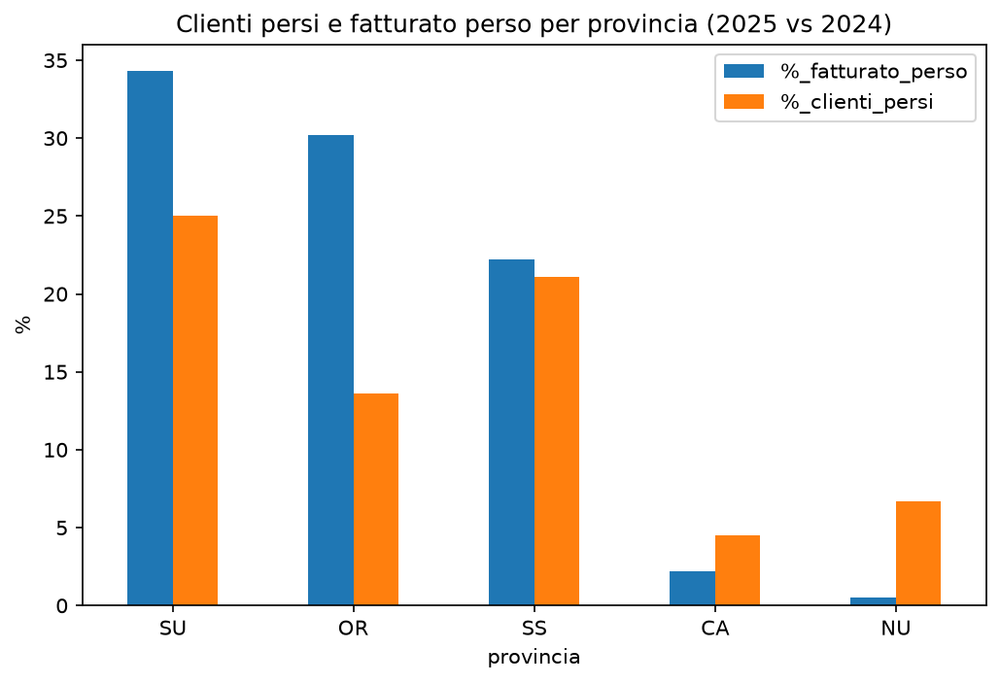

# Analisi del calo di fatturato – azienda di fertilizzanti e biostimolanti

## In breve
Analisi delle vendite 2024-2025 di un'azienda sarda di fertilizzanti e biostimolanti. Nel 2025 il fatturato è sceso del 27%, soprattutto per la perdita di 17 clienti che nel 2024 valevano 463.000 €, circa due terzi del calo. I resi, invece, sono diminuiti. Le perdite maggiori sono in Sud Sardegna (−34% del fatturato provinciale), Oristano (−30%) e Sassari (−22%). A Oristano sono bastati 3 clienti persi su 22, perché erano il 2°, il 4° e il 6° per fatturato nel 2024.

## Dati
Le tabelle contengono dati simulati:
- **ordini**: id_ordine | data_ordine | id_cliente | codice_prodotto | quantita | unita | prezzo_unitario_eur
- **clienti**: id_cliente | ragione_sociale | provincia | coltura_principale | ettari
- **prodotti**: codice_prodotto | nome | categoria | unita | prezzo_listino

## Workflow
1. **Pulizia dei dati**, con 6 problemi trovati e risolti:
    - date in due formati (YYYY-MM-DD e DD/MM/YYYY), convertite separatamente;
    - 37 ordini duplicati, di cui uno nascosto dal formato della data;
    - unità di misura scritte in modi diversi (L, Lt, kg, KG…), uniformate;
    - province scritte sia per esteso sia con la sigla, uniformate;
    - 39 quantità negative, verificate come resi e tenute nel fatturato netto;
    - 27 prezzi mancanti, stimati dal listino e segnalati.
2. **Fatturato annuale** 2024 e 2025 e variazione percentuale.
3. **Verifica di due ipotesi sul calo:** aumento dei resi (esclusa) e perdita di clienti (confermata).
4. **Analisi per provincia:** tasso di abbandono dei clienti e quota di fatturato perso.
5. **Approfondimento su Oristano:** fatturato dei singoli clienti persi.

## Risultati

| Provincia | Fatturato 2024 (tutti i clienti) | Fatturato 2024 dei clienti persi | Clienti 2024 | Clienti persi |
|---|---|---|---|---|
| Sud Sardegna | 481.000 € | 165.000 € | 16 | 4 |
| Oristano | 271.000 € | 82.000 € | 22 | 3 |
| Sassari | 908.000 € | 201.000 € | 38 | 8 |
| Cagliari | 562.000 € | 12.000 € | 22 | 1 |
| Nuoro | 430.000 € | 2.000 € | 15 | 1 |

## Conclusioni per il cliente
- **Il calo non dipende dalla qualità dei prodotti:** i resi sono diminuiti del 63%.
- **La causa principale è la perdita di 17 clienti**, che spiega circa due terzi del calo. Il resto va ancora indagato.
- **Oristano è il caso più critico in proporzione:** pochi clienti persi, ma tra i più importanti della provincia.
- **Cosa fare:**
    1. contattare i clienti persi, partendo da quelli con il fatturato più alto;
    2. verificare se il calo dei clienti rimasti dipende dalla coltura o dalla dimensione aziendale.

## Strumenti
Python · pandas · matplotlib